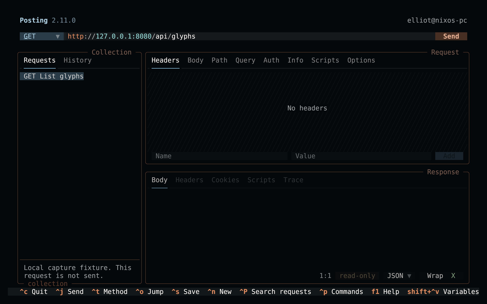
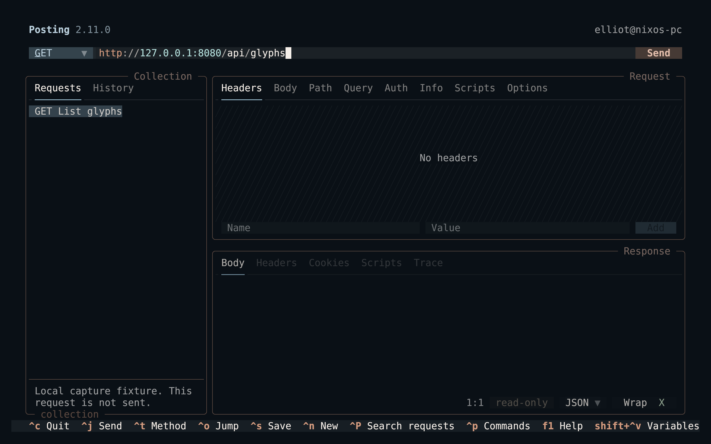
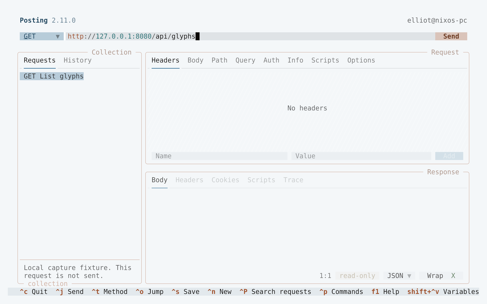
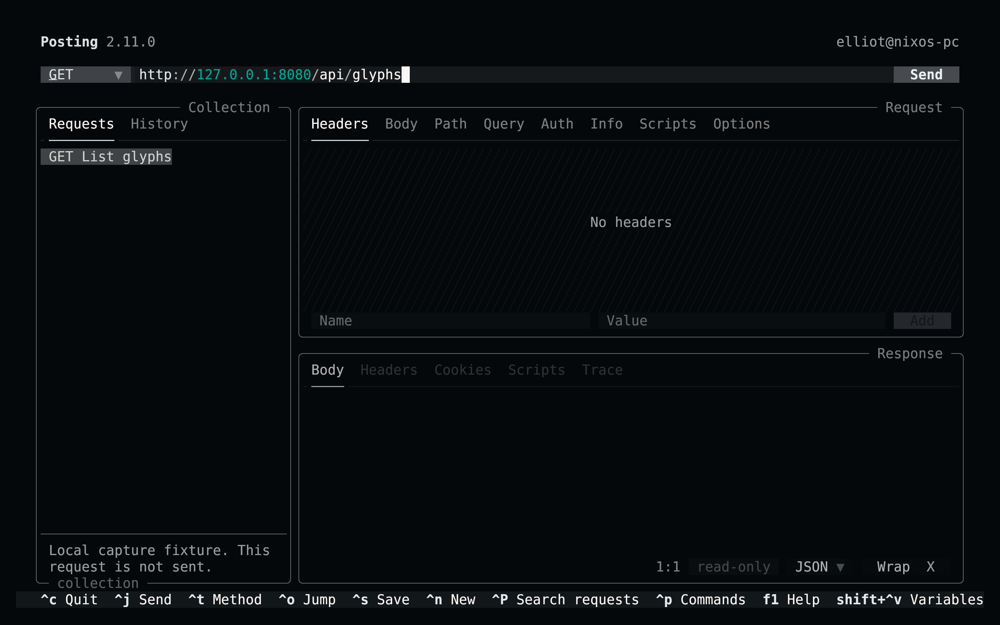

<!-- living-code-readme:1 -->
# 📮 Living Code for Posting

**Calm slate. Living color.** Living Code for Posting: native YAML palettes for HTTP requests, response status, syntax colors, focus and layered UI surfaces.

[Installation](#installation) · [Flavors](#flavors) · [Configuration](#configuration) · [All ports](https://github.com/living-code-theme)

## Previews

<table data-lc-flavors>
<tr>
<td width="50%" valign="top">
<strong>Night</strong><br><sub>Dark · full palette</sub><br><br>
<a href="images/night.png"></a>
</td>
<td width="50%" valign="top">
<strong>Frost</strong><br><sub>Dark · softer chroma</sub><br><br>
<a href="images/frost.png"></a>
</td>
</tr>
<tr>
<td width="50%" valign="top">
<strong>Paper</strong><br><sub>Light · near-white slate</sub><br><br>
<a href="images/paper.png"></a>
</td>
<td width="50%" valign="top">
<strong>Signal</strong><br><sub>Dark · teal accent</sub><br><br>
<a href="images/signal.png"></a>
</td>
</tr>
</table>

Select any preview to view the image at full size.

## Installation

```sh
flavor=night # night, frost, paper, or signal
theme_dir="$(posting locate themes)"
curl -fsSL --create-dirs -o "$theme_dir/living-code-$flavor.yaml" "https://raw.githubusercontent.com/living-code-theme/posting/main/themes/living-code-$flavor.yaml"
POSTING_THEME="living-code-$flavor" posting
```

`posting locate themes` supplies the application’s actual theme directory, so the download works with custom and platform-specific data locations. Restart an already running Posting instance after adding a new file. No existing config or collection is replaced.

## Flavors

Expand a flavor for its full-size preview and activation instructions.

<details data-lc-flavor="night">
<summary><strong>Night</strong> · Dark · full palette</summary>

<p><a href="images/night.png"></a></p>

```sh
POSTING_THEME=living-code-night posting
```

</details>

<details data-lc-flavor="frost">
<summary><strong>Frost</strong> · Dark · softer chroma</summary>

<p><a href="images/frost.png"></a></p>

```sh
POSTING_THEME=living-code-frost posting
```

</details>

<details data-lc-flavor="paper">
<summary><strong>Paper</strong> · Light · near-white slate</summary>

<p><a href="images/paper.png"></a></p>

```sh
POSTING_THEME=living-code-paper posting
```

</details>

<details data-lc-flavor="signal">
<summary><strong>Signal</strong> · Dark · teal accent</summary>

<p><a href="images/signal.png"></a></p>

```sh
POSTING_THEME=living-code-signal posting
```

</details>

## Configuration

To keep a flavor permanently, set `theme: living-code-night` in Posting’s existing config. You can preview themes through **Ctrl+P → Theme…**. Each YAML file declares its name, light/dark appearance and all supported base palette colors. Posting derives HTTP method and syntax colors from those palette fields; no ignored legacy syntax blocks are shipped.

## Compatibility

Targets Posting 2.11+’s native palette API; the same base fields are also understood by Posting 2, but version-specific rendering is not claimed. Paper explicitly sets `dark: false`. `load_user_themes` must be enabled, and `theme_directory` may override the default location. Tests parse YAML and verify the documented supported field set.

Previews are captured programmatically from the actual application in an isolated profile. See [`capture/app.py`](capture/app.py) for the app-owned recipe and [`images/capture.json`](images/capture.json) for runtime, palette and image provenance. No mock interface is drawn.

## Contributing

Found a problem? [Open an issue](https://github.com/living-code-theme/posting/issues/new/choose) with the app version, the flavor and a screenshot. Want Living Code somewhere else? [Request a port](https://github.com/living-code-theme/core/issues/new?template=port-request.yml).

Pull requests are welcome. Keep this README, `port.json` and `images/` in sync, and use real screenshots of the app, never mockups.

🦎 **One chameleon, many habitats.** Part of [Living Code](https://github.com/living-code-theme).

## License

[MIT](LICENSE) © Elliot Luque
